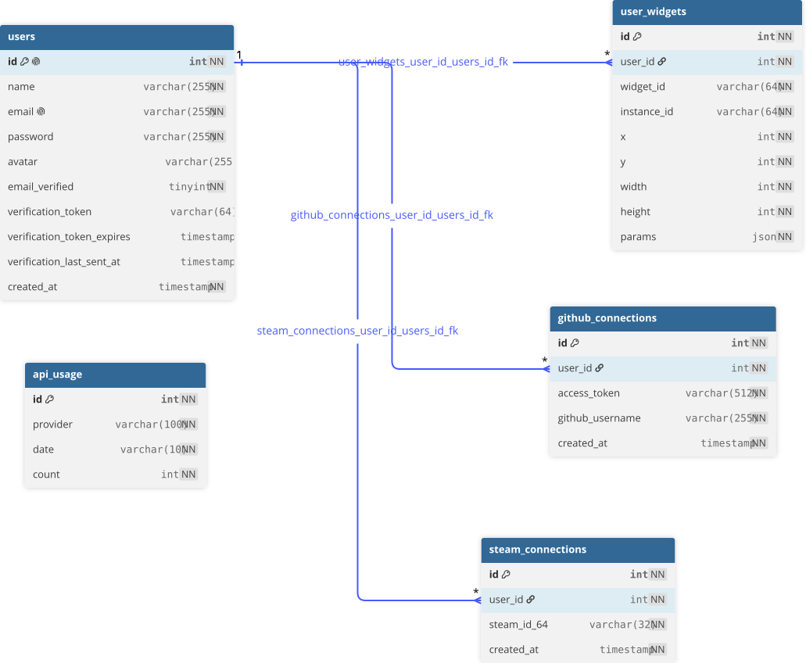

# DataBase information

[backlink](../README.md#dashboard)

Table of contents:
1. **[db schema](#db-schema)**
2. **[changing the db](#changing-the-db)**
3. **[what we do with your data](#what-we-do-with-your-data)**

# db schema


To generate the dbml you can run:
```sh
docker compose run --rm backend npm run dbml:generate
```

# changing the db

You edit **[db/schema.ts](../back/src/db/schema.ts)** then run the following command at the root of the repo:
```sh
docker compose run --rm backend npm run db:generate
```

# what we do with your data

your data is only used inside the dashboard, except for github and steam, where the data is used by their respective authentication systems. \
not other third-parties have access to your data. \
Upon deletion of your account, ALL of your data is removed from the app's database. \
all credentials are kept encrypted inside the database.

